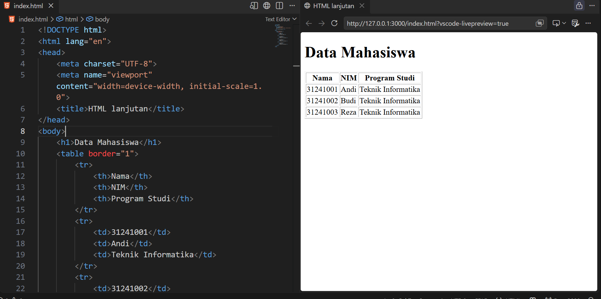
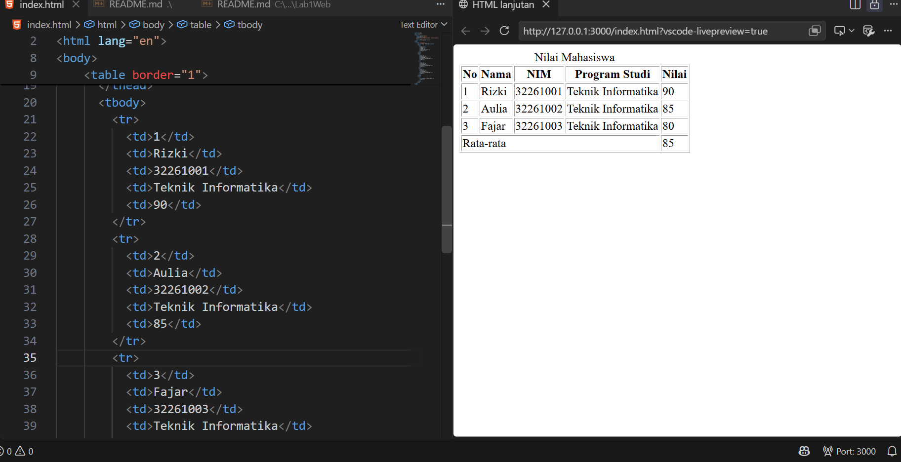
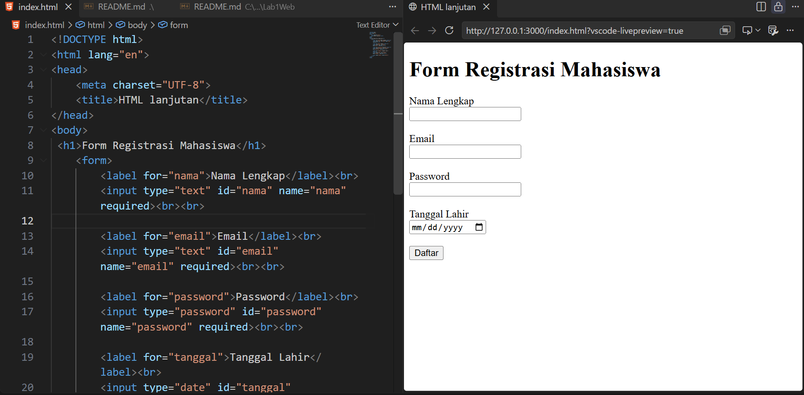
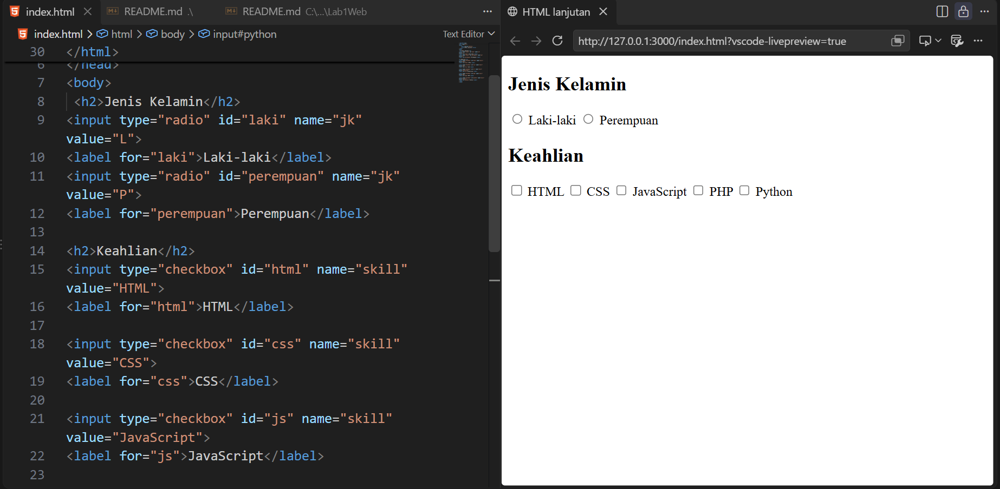
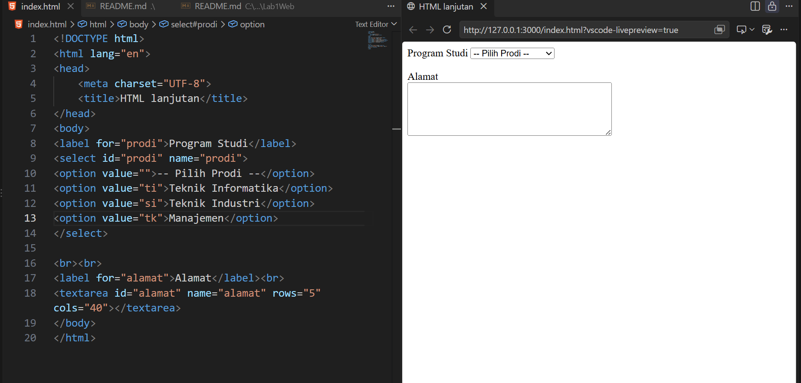
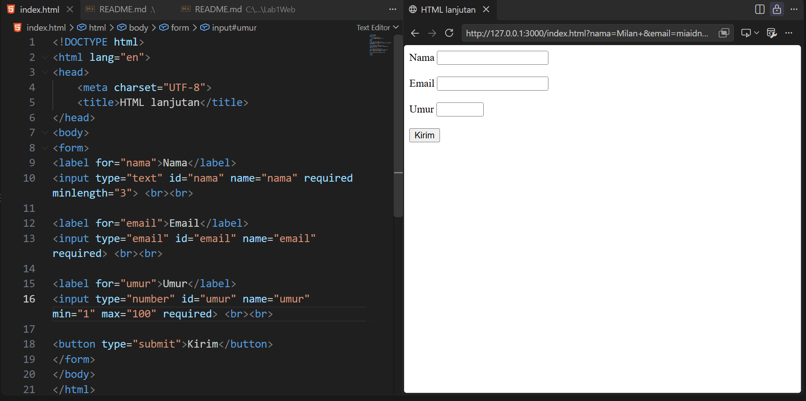
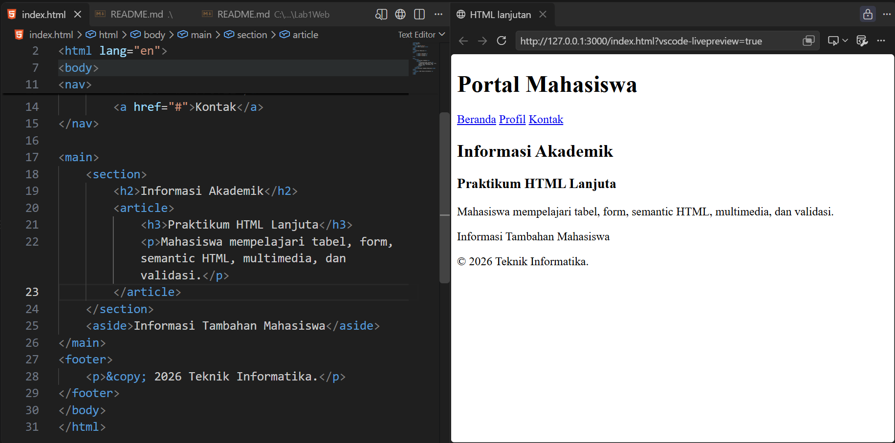
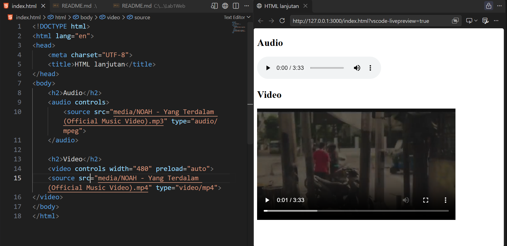
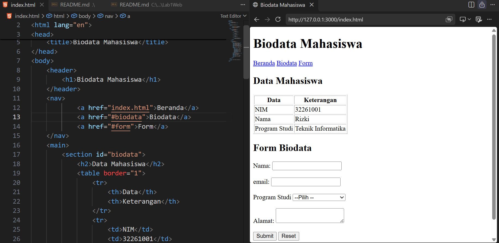

# praktikum 2 : HTML Lanjutan - Lab2Web

**Nama**        : Milan Nurwiyadi  
**NIM**         : 312510073  
**Kelas**       : I253B  
**Dosen**       : Sufajar Butsianto, S.Kom, M.Kom.  
**Mata Kuliah** : Pemograman WEB

=================================================================================================
# Langkah - Langkah Praktikum 

1. Membuat struktur folder `praktikum-2-html-lanjutan`beserta folder `image,media`
2. Membuat file utama `index.html` yang berisikan : 
- Tabel HTML `<tabel`>,`<tr>`,`<th>`,`<td>`

- Pengembangan Tabel HTML `<thead>`, `<tbody>`, `<tfoot>`, dan `colspan`

- Form Registrasi dengan berbagai jenis input `text`, `email`, `password`, `date`, .dan button `submit`,`reset`

- Penambahan Radiobutton dan checkbox pada form`radio`,`checkbox`

- Penambahkan Elemen interaktif seperti `<select>` dan `<textarea>`.

- Validasi form dasar (`required`, `minlength`, `maxlength`, `min`, `max`).

<video controls width="480"> 
<source src="media/Rekaman Step6.mp4" type="video/mp4"> 
</video>  

- Struktur Semantic HTML (`<header>`, `<nav>`, `<main>`, `<section>`, `<article>`, `<aside>`, `<footer>`).

- Penyematan elemen multimedia (`<audio>` dan `<video>`).

3. Membuat proyek mini halaman biodata mahasiswa
```
<!DOCTYPE html>
<html lang="en">
<head>
    <meta charset="UTF-8">
    <title>Biodata Mahasiswa</title>
</head>
<body>
    <header>
        <h1>Biodata Mahasiswa</h1>
    </header>
    <nav>
            <a href="index.html">Beranda</a>
            <a href="#biodata">Biodata</a>
            <a href="#form">Form</a>
    </nav>
    <main>
        <section id="biodata">
            <h2>Data Mahasiswa</h2>
            <table border="1">
                <tr>
                    <th>Data</th>
                    <th>Keterangan</th>
                </tr>
                <tr>
                    <td>NIM</td>
                    <td>32261001</td>
                </tr>
                <tr>
                    <td>Nama</td>
                    <td>Rizki</td>
                </tr>
                <tr>
                    <td>Program Studi</td>
                    <td>Teknik Informatika</td>
                </tr>
            </table>
        </section>

        <sction id="form">
            <h2>Form Biodata</h2>
            <form>
                <label for="nama">Nama:</label>
                <input type="text" id="nama" name="nama" required><br><br>
                <label for="email">email:</label>
                <input type="email" id="email" name="email" required><br><br>
                <label for="prodi">Program Studi</label>
                <select id="prodi" name="prodi" required>
                    <option value="">--Pilih --</option>
                    <option value="ti">Teknik Informatika</option>
                    <option value="si">Sistem Informasi</option>
                    <option value="tk">Teknik Komputer</option>
                </select><br><br>
               <label for="alamat">Alamat:</label>
                <textarea id="alamat" name="alamat" required></textarea><br><br>
                <button type="submit">Submit</button>
                <button type="reset">Reset</button>
            </form>
        </sction>
    </main>
    <footer>
        <p>&copy; 2026 Teknik Informatika</p>
    </footer>
</body>
</html>
```


==================================================

# MENJAWAB PERTANYAAN PERTANYAAN
1. Apa fungsi `<table>`, `<tr>`, `<th>`, dan `<td>`?  
**JAWABAN**
- `<table>`: Membuat tabel dalam HTML.
- `<tr>`: Membuat baris pada tabel.(table row).
- `<th>`: Membuat sel judul atau kepala kolom tabel. (table header).
- `<td>`: Membuat sel untuk menampilkan data tabel (table data).

2. Apa perbedaan `<th>` dan `<td>`?  
**JAWABAN**
- `<th>`(Table Header): Digunakan untuk membuat sel judul atau kepala kolom tabel. Secara default, teks biasanya ditampilkan tebal dan rata tengah.Sedangkan
- `<td>`(Table Data): Digunakan untuk membuat sel yang berisi data atau informasi pada tabel.

3. apa fungsi colspan pada tabel?   
**JAWABAN**  
- Atribut `colspan` berfungsi untuk menggabungkan beberapa kolom menjadi satu sel dalam tabel.

4. Apa fungsi `<form>` dalam HTML?   
**JAWABAN**
- Elemen `<form>` digunakan untuk membuat formulir yang memungkinkan pengguna memasukkan dan mengirimkan data, seperti formulir login, pendaftaran, dan kontak.

5. Apa perbedaan radio button dan checkbox?  
**JAWABAN**
- *Radio button*: Memungkinkan pengguna memilih satu pilihan dari beberapa pilihan dalam kelompok yang sama.
- *Checkbox*: Memungkinkan pengguna memilih satu atau lebih pilihan secara bersamaan.

6. Mengapa `<label>` sebaiknya terhubung dengan id input melalui atribut for?   
**JAWABAN**
- Agar label terhubung dengan input yang sesuai. Pengguna dapat mengeklik label untuk memilih atau mengaktifkan input, sehingga formulir lebih mudah digunakan dan lebih aksesibel.

7. Apa perbedaan `<textarea>` dengan input type text? 
**JAWABAN**
- `<textarea>` digunakan untuk memasukkan teks panjang atau beberapa baris, seperti komentar dan alamat.
- `<input type="text">` digunakan untuk memasukkan teks singkat dalam satu baris, seperti nama atau kota.
8. Apa fungsi semantic HTML seperti `<header>, <nav>, <main>, <section>, <article>, <aside>,` dan 
`<footer>`?   
**JAWABAN**  
Semantic HTML adalah elemen HTML yang menjelaskan makna dan fungsi bagian halaman web.
- `<header>`: Menampilkan bagian kepala halaman atau bagian konten.
- `<nav>`: Menampung tautan navigasi.
- `<main>`: Menampung konten utama halaman.
- `<section>`: Mengelompokkan konten berdasarkan tema tertentu.
- `<article>`: Menampung konten mandiri, seperti artikel atau berita.
- `<aside>`: Menampilkan konten tambahan, seperti sidebar.
- `<footer>`: Menampilkan bagian bawah halaman, seperti informasi hak cipta.

9. Apa fungsi `required, min, max,` dan `minlength`? 
**JAWABAN**
- **required**: Menentukan bahwa input wajib diisi.
- **min**: Menentukan nilai minimum yang diperbolehkan.
- **max**: Menentukan nilai maksimum yang diperbolehkan.
- **minlength**: Menentukan jumlah minimum karakter yang harus dimasukkan.

10. Apa perbedaan elemen `<audio>` dan `<video>`?
**JAWABAN**
- `<audio>` digunakan untuk menambahkan dan memutar suara atau musik pada halaman web.
- `<video>` digunakan untuk menambahkan dan memutar video pada halaman web.